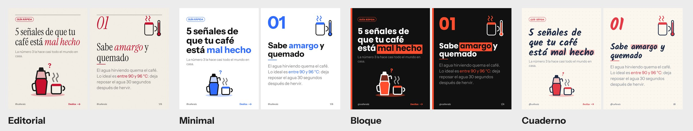

# carrusel-pro

Le dices a Claude **"hazme un carrusel de…"** y te entrevista (tema, marca, estilo, Canva o no), te propone el texto, dibuja las ilustraciones y te entrega las imágenes listas para Instagram o TikTok, con la descripción y los hashtags.

### [⬇️ Descargar carrusel-pro.zip](https://github.com/dakexplica/carrusel-pro/releases/latest/download/carrusel-pro.zip)

Solo esta herramienta, lista para subir a Claude (no la descomprimas).



## Instalar

### En Claude Code (con un comando)

```bash
npx skills add dakexplica/carrusel-pro
```

### En la app de Claude (lo más fácil)
1. Toca **⬇️ Descargar carrusel-pro.zip** (arriba). Déjalo así, no lo abras.
2. Abre Claude, toca tu nombre abajo a la izquierda y entra a **Configuración → Capacidades**.
3. En **Skills**, dale a **Subir skill** y elige el archivo. Si no te aparece, enciende antes **Ejecución de código**.
4. ¡Listo! Abre un chat nuevo y pídele un carrusel.

También puedes usar el botón verde **Code → Download ZIP** de esta página: baja solo esta herramienta.

## Qué trae
- 4 estilos: Editorial, Minimal, Bloque y Cuaderno
- Tu marca: tus colores, tipografía y logo; la saca de tu web, o te inventa una
- Ilustraciones nuevas para cada tema
- Instagram 4:5 y TikTok en modo foto
- Serie de 5 carruseles con calendario
- Descripción + hashtags

## Pruébala con esto

> Hazme un carrusel de 6 láminas sobre cómo preparar un buen café en casa, para la cuenta de una cafetería.

Más herramientas gratis: **[dakexplica.derekavelar.com](https://dakexplica.derekavelar.com)** · [github.com/dakexplica](https://github.com/dakexplica)

Hecha por [@dakexplica](https://www.instagram.com/dakexplica). Gratis para usar y compartir.
